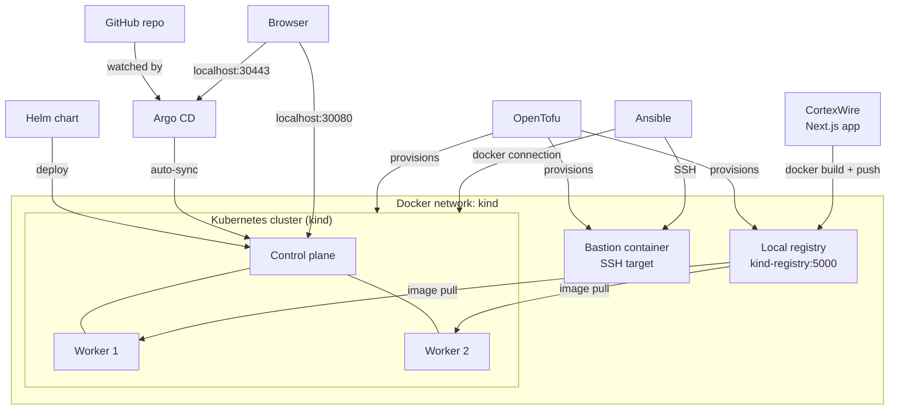

# mini-cloud-platform 🚀
# Mini-Cloud Platform: Kubernetes with OpenTofu, Ansible, Helm and Argo CD


A complete, **zero-cost local platform** that reproduces the shape of a real industry setup (infrastructure as code → configuration management → containers → Kubernetes → GitOps) on a single laptop under WSL2.

It was built in a **network-restricted environment** where Docker Hub, `quay.io` and the HashiCorp download servers were blocked, so a large part of the work was diagnosing and fixing real infrastructure problems, and those lessons are documented in the case study.

> 📄 **Full case study** (architecture, 8 challenges and fixes, chaos test): [`docs/architecture.md`](docs/architecture.md) (written in Persian)

## Highlights

- **Infrastructure as code**: OpenTofu provisions a Docker network, a private image registry, an SSH bastion and a 3-node Kubernetes cluster (1 control plane + 2 workers) on `kind`.
- **Configuration management**: Ansible configures the bastion over SSH and the cluster nodes through the Docker connection plugin.
- **Containerised app**: a Next.js app (CortexWire) packaged with a 3-stage Docker build, running as a non-root user.
- **Helm chart**: custom chart with a Deployment, a Service, resource requests/limits, and liveness and readiness probes.
- **GitOps**: Argo CD watches this repository and syncs the chart automatically with self-heal and prune.
- **Verified behaviour**: GitOps loop tested end to end, and Kubernetes self-healing observed during a real node failure (details below).

## Architecture



## Repository structure

| Path | Purpose |
|---|---|
| `terraform/` | OpenTofu code: Docker network, local registry, bastion, `kind` cluster config (templated) |
| `ansible/` | Inventory, playbooks (`configure-bastion.yml`, `configure-kind-nodes.yml`) and the bastion image |
| `app/` | CortexWire, a Next.js app with a multi-stage `Dockerfile` |
| `helm-chart/cortexwire/` | Helm chart (Deployment, Service, probes, resources, 3 replicas by default) |
| `docs/architecture.md` | Case study with architecture, challenges, lessons learned and limitations |

## Tech stack

| Tool | Version used | Role |
|---|---|---|
| OpenTofu | 1.12.6 | Provision network, registry, bastion and cluster as code |
| kind | v0.32.0 | Real Kubernetes cluster running inside Docker containers |
| Ansible | core 2.20.1 | Configure the bastion (SSH) and the kind nodes (Docker connection) |
| Docker | 29.1.3 | Container engine (native in WSL2) |
| Helm | v3.21.4 | Package and deploy the application |
| Argo CD | v3.5.3 | GitOps continuous delivery |
| Next.js | 15.5.22 | The deployed application |

## Quick start

**Prerequisites:** Docker, OpenTofu (or Terraform ≥ 1.6), `kind`, `kubectl`, Helm, Ansible with the `community.docker` collection (`ansible-galaxy collection install community.docker`), and optionally the Argo CD CLI.

```bash
# 1. Infrastructure: network, registry, bastion, 3-node cluster
cd terraform
tofu init && tofu apply

# 2. Configuration management
cd ../ansible
ansible-playbook playbooks/configure-bastion.yml
ansible-playbook playbooks/configure-kind-nodes.yml

# 3. Build and push the app to the local registry
cd ../app
docker build -t localhost:5001/cortexwire:v1 .
docker push localhost:5001/cortexwire:v1

# 4a. Deploy directly with Helm ...
cd ../helm-chart
helm install cortexwire ./cortexwire --kube-context kind-mini-cloud

# 4b. ... or hand control to Argo CD (do not do both: see "Lessons learned")
kubectl create namespace argocd
kubectl apply -n argocd -f https://raw.githubusercontent.com/argoproj/argo-cd/stable/manifests/install.yaml
argocd app create cortexwire-gitops \
  --repo https://github.com/ehsanrezaiegit/mini-cloud-platform \
  --path helm-chart/cortexwire \
  --dest-server https://kubernetes.default.svc --dest-namespace default \
  --sync-policy automated --self-heal --auto-prune
```

The app is then available at **http://localhost:30080**. The Argo CD UI is on port **30443** once the `argocd-server` service is exposed as a NodePort (this step is not yet part of the IaC, see limitations).

Tear everything down with `tofu destroy` in `terraform/`.

## Verified behaviours

**GitOps end to end.** `replicaCount` in `values.yaml` was changed from 2 to 3 and pushed to GitHub, with no manual cluster commands. Argo CD detected the change within seconds and created the third pod.

**Self-healing under a real failure.** During development a worker container was killed (exit code 137, most likely RAM pressure on WSL2 with the cluster, Argo CD and a monitoring lab running together). Kubernetes rescheduled its pods onto the healthy worker without human intervention, and the node rejoined as `Ready` within seconds after `docker start`.

## Lessons learned (short version)

| Problem | Fix |
|---|---|
| `403` pulling from Docker Hub | Registry mirror configured on the native Docker daemon in WSL2 (and checking `docker context ls` to be sure which daemon is in use) |
| HashiCorp / kind download endpoints blocked | Switched to OpenTofu and downloaded binaries directly from GitHub releases |
| `403` pulling Argo CD images from `quay.io` | Mirror set in the `containerdConfigPatches` of the kind config, at the layer where the pull actually happens |
| Nodes tried HTTPS against the HTTP-only local registry | Explicit containerd registry config for `kind-registry:5000` |
| NodePort not reachable from the host | `extraPortMappings` in the kind config for every exposed port |
| Sync conflict between manual `helm install` and Argo CD | One owner per resource: uninstall the manual release before handing over to Argo CD |
| Manual `kubectl patch` lost on every cluster rebuild | Anything that must persist belongs in code, not in ad-hoc commands |

The full write-up with commands and reasoning is in [`docs/architecture.md`](docs/architecture.md).

## Known limitations

This is a **local lab environment**, not a production setup, and the following shortcuts are deliberate and documented:

- The bastion uses a simple password (`devops`) and the Ansible inventory contains it in plain text. For production use SSH keys and Ansible Vault.
- Ansible host-key checking is disabled for the local environment.
- Argo CD uses a self-signed TLS certificate.
- The Argo CD NodePort exposure is applied manually and is not yet in the IaC.
- It is a single-host simulation: no real cloud networking, load balancer or multi-node hardware failure domain. RAM limits on WSL2 caused a real node failure during development.

## Roadmap

- [ ] Add the Argo CD installation and NodePort exposure to the OpenTofu/Helm code
- [ ] Replace password auth with SSH keys and enable host-key checking
- [ ] Add the monitoring stack (see [devops-monitoring-lab](https://github.com/ehsanrezaiegit/devops-monitoring-lab)) to the cluster
- [ ] Add an Ingress controller and TLS
- [ ] Wire CI (see [CI-CD](https://github.com/ehsanrezaiegit/CI-CD)) to build the image and update the chart tag automatically

## Author

**Ehsan Rezaie**: DevOps & Full-Stack Engineer · [GitHub](https://github.com/ehsanrezaiegit) · [Portfolio](https://plugifly.shop)
